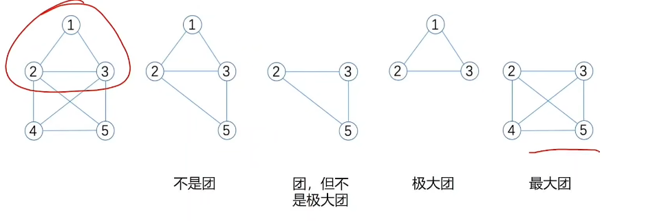
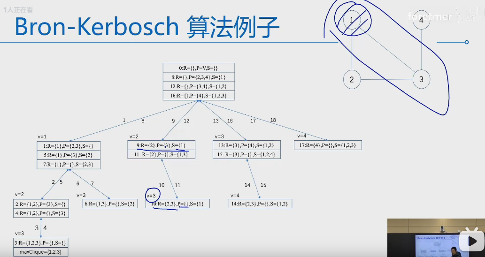
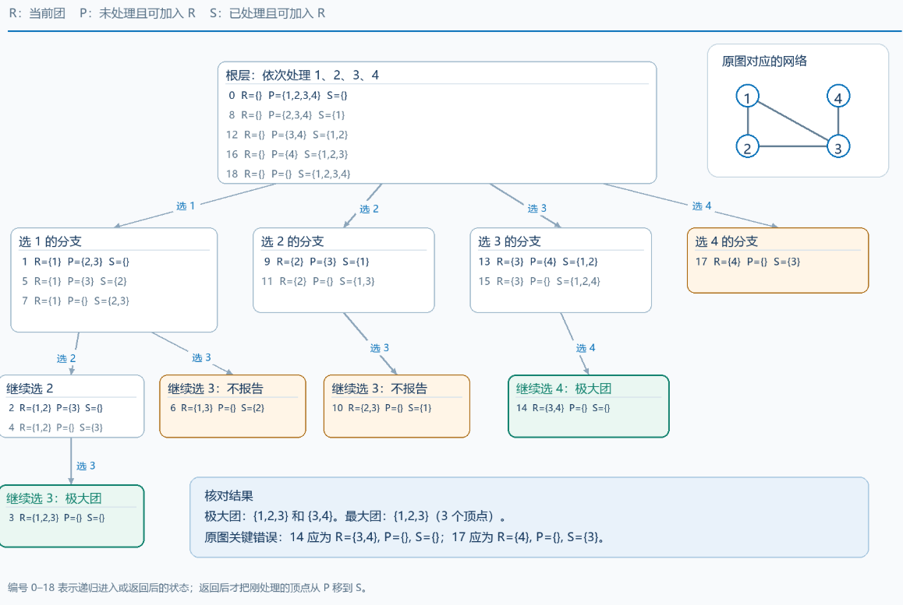

### 最大团问题

> 完全子图（团）： 是指在给定**无向图**中 ，**任意两个顶点**之间存在边相连的子图。 
>
> 最大完全子图 ：  指所有完全子图中， 顶点数最多的完全子图。
>
> 完全图： 图中任意两点都有一条边相连的图。
>
> 
>
> 团（clique） ：给定一个无向图 G=（V，E）,**团就是图G 的一个完全子图**   。
>
> 极大团(maximal clique)： 在图G 中，如果**一个团不被其他任何一个团所包含** ， 即**它不是其他任一团的真子集**， 则该团为图G 的极大团。
>
> 最大团（maximum cllique） ： 图G中最大的极大团为最大团。




#### 最大团问题：(回溯)




**时间复杂度O（n2^n^）：** 

1. 每个顶点 都有选 或不选 两种可能 所以递归搜索树最多有O(2 ^n^) 个节点
2. 在一个节点中 ，`for i=1 to n ` 最多检查n 次 ，耗时O(n)


#### Bk 框架 

思路：  选取一个节点 ， 从这个节点的邻节点随机选取一个节点 ， 再从**这两个节点的共同邻节点选取一个节点**，依次类推 ， 每次都从已经选取过的共同邻节点选取一个节点加入团 ，直到再也找不到**共同邻节点**，形成的团就是极大团。 

剪枝： 对某个节点进行过极大团搜索 ， 而v~i~ 的当前团的邻节点， 那么将 v~i~ 加入到当前团 ，形成的团已经被搜索过了  （可以通过数组S来保存已经被搜索过的节点）

S 集合的形成 ：

   1.父节点继承

 2. 已经 访问过的兄弟节点

```c++

 最大团回溯算法 2

1: 输入：图 G = (V, E)
2: 初始化：R ← ∅, P ← V, S ← ∅, maxNumber ← 0, maxNodes ← ∅   //R 表示当前团的顶点数 ， P代表当前团的共同邻居 ，S 代表访问过的节点 
3: maxClique2(R, P, S) ;

   maxClique2(R, P, S)
1: if P = ∅ then          // 到达叶子节点 递归出口
2:     if |R| > maxNumber then
3:         maxNumber ← |R|
4:         maxNodes[] ← R
5:     end if
6: end if
    
7: for each v ∈ P do
8:     if v ∈ S then    // 从P中选取的点在S（访问过） 中  ，丢弃  （剪枝）
9:         continue
10:     end if
11:     R' ← R ∪ {v}     // 更新R，p ,S 
12:     N ← v 的邻节点
13:     P' ← P ∩ N
14:     maxClique2(R', P', S)   // 当递归完 更新S 
15:     S ← S ∪ {v}
16: end for

```


``` c++
Algorithm 66 Bron-Kerbosch 算法

1: 输入：图 G = (V, E);
2: 初始化：R ← ∅, P ← V, S ← ∅, max_Number ← 0, max_Nodes ← ∅;
3: Bron-Kerbosch(R, P, S);

Bron-Kerbosch(R, P, S)
1: if P = ∅ and S = ∅ then   // 3️⃣  因此 相当于 没有共同邻居p= 空集  以及  当前团的邻节点没有有已经被搜索过的节点  则表明 是极大团1 
2:     if |R| > max_Number then
3:         max_Number ← |R|;
4:         max_Nodes[] ← R;
5:     end if
6: end if
7: for each v ∈ P do
8:     Bron-Kerbosch(R ∪ v, P ∩ N(v), S ∩ N(v));
9:      S ← S ∪ v;  // v 已经处理过了 ， s 一直保留处理过的节点    1️⃣
10:     P ← P \ v;  // v已经出过了 直接拿掉   2️⃣
11: end for
```

- S： 可以表示**当前团的邻节点**中已经被搜索过的节点 
- p:   可以表示当前团的邻节点中未被搜索过的节点 


